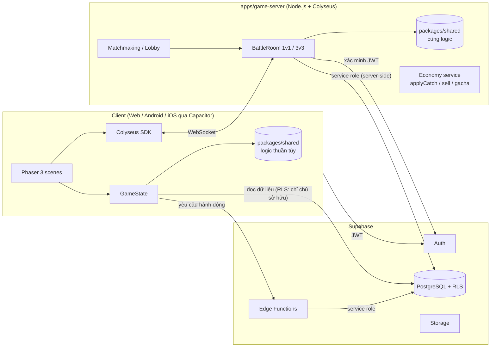
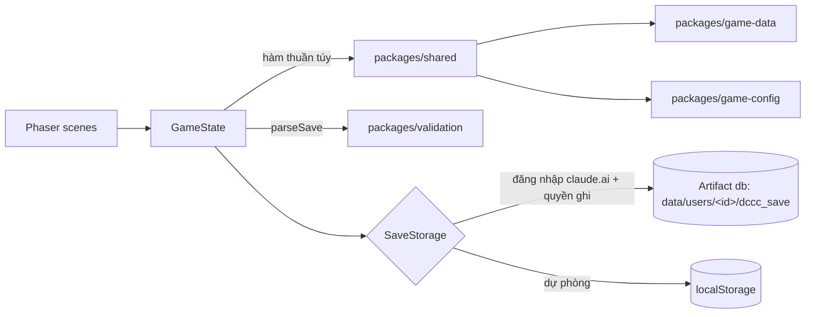

# TECHNICAL ARCHITECTURE

## 1. Sơ đồ hệ thống (đích Giai đoạn 4+)

**Nguyên tắc:** server là nguồn dữ liệu có thẩm quyền. Client chỉ gửi *ý định* (chọn kỹ năng, chọn cá, xác nhận lượt; ở câu cá: seed + chuỗi input). Server chạy lại cùng hàm trong `packages/shared` để tính kết quả, cấp thưởng có `txId` duy nhất.

## 2. Hiện trạng Giai đoạn 1

- Lưu đám mây Giai đoạn 1 là **tạm thời**: dùng kho dữ liệu riêng tư theo tài khoản của trang Artifact. Dữ liệu vẫn do client ghi nên **chưa chống gian lận** – chấp nhận được cho MVP chơi đơn; GĐ4 thay bằng Supabase + server.
- Save luôn được kiểm tra bằng schema Zod + kiểm tra tham chiếu dữ liệu trước khi dùng.

## 3. Công nghệ & phiên bản (khóa chính xác)
| Thành phần | Phiên bản |
|---|---|
| Node.js | ≥ 22 |
| pnpm | 10.28.0 |
| TypeScript | 5.9.3 |
| Phaser | 3.90.0 (bản 3.x mới nhất; Phaser 4 đã ra nhưng yêu cầu dự án là Phaser 3) |
| Vite | 7.3.8 (+ vite-plugin-singlefile 2.3.4 cho bản 1 file) |
| Vitest | 4.1.12 |
| Zod | 4.6.7 |
| ESLint / typescript-eslint / Prettier | 10.15.0 / 8.73.0 / 3.10.1 |
| Colyseus (GĐ4) | dòng 0.18.x (`colyseus` 0.18.12, `@colyseus/sdk` 0.18.x) – sẽ kiểm tra tài liệu + skill `colyseus/skill` trước khi viết |
| Supabase JS (GĐ4) | 2.x |
| Capacitor (GĐ6) | 8.x |

## 4. Tính tất định & chống gian lận
- `Rng` (mulberry32) có seed; `FishingSession` bước 50 ms cố định. Test `fishing.test.ts` khẳng định cùng seed + input ⇒ cùng kết quả.
- GĐ4: client gửi `{seed được server cấp, input log}`; server phát lại, kiểm tra thời lượng hợp lý, rồi gọi `applyCatch`. Seed do server cấp nên client không chọn được cá.
- Kinh tế: `appliedTx` + `ledger` chống nhận trùng; GĐ4 chuyển thành bảng `economy_transactions` với `UNIQUE(tx_id)`.

## 5. Schema dữ liệu dự kiến (GĐ4 – Supabase)
`profiles`, `player_progress`, `player_characters`, `player_rods`, `player_fishes`, `inventory`, `currencies`, `economy_transactions (tx_id UNIQUE)`, `fishing_records (seed, input_log)`, `battle_records (seed, actions)`, `battle_participants`, `matchmaking_ratings`, `quests`, `quest_progress`, `achievements`, `gacha_records`, `clans`, `clan_members`, `aquarium_displays`, `social_interactions`, `events`, `leaderboard_snapshots`.
RLS: người chơi chỉ SELECT dữ liệu của mình; **không** có policy INSERT/UPDATE cho bảng tiền tệ, chỉ số, phần thưởng, xếp hạng – chỉ server (service role) ghi. Migration sẽ được viết và chạy thử trên Postgres thật ở GĐ4.

## 6. Hiệu năng
- Không có file ảnh: mọi hình vẽ thủ tục bằng Canvas2D một lần thành texture, tạo lazy theo khu vực/cá cần dùng.
- Bản build một file ~1,4 MB (gzip ~405 KB), gồm cả Phaser.
- Âm thanh tổng hợp bằng WebAudio, không tải file.
- Hạt hiệu ứng dùng emitter có `stopAfter` để tự hủy.

## 7. Triển khai
- Web hiện tại: claude.ai Artifact (một file HTML, `pnpm build:artifact`).
- Production (GĐ6): static hosting (Vercel/Netlify/Cloudflare Pages) cho client, Colyseus trên VPS/Fly.io/Render, Supabase managed.
